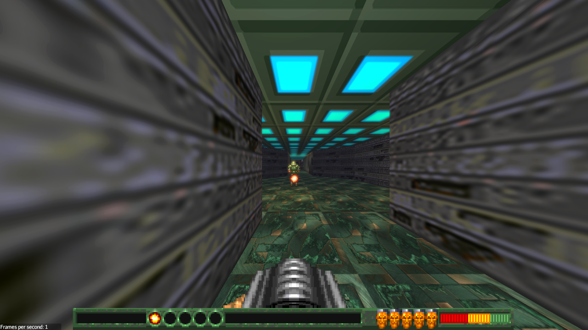

# Gloom Rebirth — 3D view

*[Version française](README_fr.md)*

Real-time 3D view (jMonkeyEngine) of the Java port of *Gloom* (Black Magic Software, Amiga, 1995).
It replays **the same ported game** as `../gloom-java/`: the simulation is still the assembly one
(`Objects`, `Player`, `Events`, `Map`, `host.Game`, `Sfx`/`MedPlayer` — same `Mem.RAM`, same
lists, same AI); only the **display and input** are replaced. The `Render` rasteriser is
not called: Rebirth reads the world state directly from 68k RAM and translates it into a jMonkeyEngine scene.

> Ported by **Guillaume Monet**, with assistance from Claude.



*3D view with the Gloom Deluxe status panel and weapon overlaid, crisp pixels.*

## Download

The binaries are in the [releases](https://github.com/guillaumemonet/gloom-rebirth/releases):
`GloomRebirth-<version>-windows-x64.zip` (bundled JRE: unzip, run `GloomRebirth.exe`) and
the Android APK. **No game data is included**: on first launch, if the Gloom Deluxe disks
cannot be found, the game offers to download them from
[Amiga Museum](https://amigamuseum.emu-france.info) — nothing happens without a yes.

---

## 1. Separation from gloom-java

This project contains **only the 3D-specific code**. The faithful engine is not copied: its sources
are compiled **as is** from the sibling project (Gradle sourceSet), so any fix to the
simulation benefits both.

```
Gloom/
├── adf/                 ← the two Gloom Deluxe disks (.adf), read directly
├── gloom-java/          ← faithful 2D port (gloom-java repo): shared engine (src/)
├── rebirth-docs/        ← OUTSIDE git: working docs, screenshots, HD textures
│   └── gloom-rebirth/hd/<episode>/wall_<slot>.png, floor.png, roof.png  (+ hd_src/ = base textures)
└── gloom-rebirth/       ← THIS project
    ├── build.gradle     ← srcDirs = src + ../gloom-java/src (without tools/, host/Main, DisplayTest)
    ├── src/gloom/rebirth/        ← Rebirth, Options, HostGlue, DesktopGlue
    ├── src/gloom/rebirth/tools/  ← TextureDump
    ├── scripts/upscale-textures.py
    ├── docs/img/        ← README screenshot
    └── android/         ← separate 3D APK (RebirthActivity, Touch3d, SetupActivity, AndroidGlue)
```

What is taken from `gloom-java`: all of `gloom.*`, `gloom.data.*` and the reused host stack
(`host.Audio`, `Font`, `Game`, `LevelScene`, `Splat`, `GpuCheck`…). On Android, it also takes
`gloom.android.AndroidAudio` and `AssetSetup` from `gloom-java/android`.

---

## 2. Building & running

### Setup

The two repositories must be **side by side** (the build reads `../gloom-java/src`):

```bash
mkdir Gloom && cd Gloom
git clone https://github.com/guillaumemonet/gloom-java      # shared faithful engine
git clone https://github.com/guillaumemonet/gloom-rebirth   # this repository
```

The game data is read **from the two Gloom Deluxe disks** (`.adf`), as in
gloom-java: `-Dgloom.adf=<folder>`, `../adf` (`Gloom/adf`), then `~/.gloom-java/adf`. If they
are missing, the game **offers** to download them from
[Amiga Museum](https://amigamuseum.emu-france.info) — nothing happens without a yes. The APK does the same on
first launch.

The HD textures are **not versioned**: they are derived from Gloom's textures, so they cannot be
redistributed. Rebirth looks for them in `gloom-rebirth/hd/` then in
`../rebirth-docs/gloom-rebirth/hd/` (or the root given by `-Dgloom.hdroot=`). They are regenerated
locally (see "HD textures" below); without them, Rebirth uses the original 64×64 textures.

### Commands

From `gloom-rebirth/`:

```bash
gradle run                        # vue 3D (= gradle rebirth)
gradle rebirth -Dshot             # capture d'une frame 3D → ../rebirth.png, puis quitte
gradle releaseZip                 # native app (bundled JRE), zipped → build/release/
gradle dumpTextures -Dmap=map1_1  # extrait les textures du niveau → ../rebirth-docs/gloom-rebirth/hd_src/map1/
cd android && gradle assembleDebug   # "Gloom Rebirth" APK (applicationId gloom.rebirth)
```

JDK 21, Gradle 9.x, Windows x64 (LWJGL natives). The working directory is `gloom-rebirth/`:
the data comes from the disks (see above), the HD textures from `./hd/` or `../rebirth-docs/gloom-rebirth/hd/`. Options are persisted
in `~/.gloom-java/rebirth.properties` (path unchanged, to keep existing settings).

**Graphics card**: at startup, the renderer name (`GL_RENDERER`) is printed to the console.

**Controls**: `W`/`S` forward/back, `A`/`D` strafe, `←`/`→` turn, **mouse** mouselook
(cursor locked), `Ctrl` fire, `Esc` = context menu (options → menu → quit).
All keys are **remappable** in the `OPTIONS` menu.

### What the 3D renderer does

| Element | 3D translation |
|---|---|
| Walls (map zones) | quads extruded to `WALL_H`, grouped by texture; **rebuilt** when a door/animation moves (`wallsHash`) — doors have their own `PolyOffset` material (anti z-fighting) |
| Floor / ceiling | real textured planes (no more software perspective) |
| Monsters, items, gibs, sparks | camera-facing **billboards** with the original sprites, 8-direction frame selection kept (`drawshape_8`), lit material |
| `ob_invisible` | the original's 3 renderings: normal, 50 % **translucent** (`drawobjtrans` — the ghoul) and **"invisible"**, which only darkens the background without showing its colour (`drawobjinvs` — powerup) |
| Thermal vision (`ob_thermo`) | second quad at the same spot, **inverted** depth test (`depthFunc Greater`) → **blue** silhouette visible only where the sprite is occluded, the pixel equivalent of the column-by-column `thermostrip` |
| Floor gore (`gore` list) | horizontal quads laid on the floor (decals) |
| Blood (`blood` list) | **a single mesh** of camera-facing quads, vertex-coloured from `bl_color` |
| Bullets | sprite + dynamic **point light** (colour per weapon type: player orange, ghoul green, phantom blue…) |
| Ambience | torch carried by the player, muzzle flash when firing, emissive textures → point lights, bloom + fog + directional shadows |
| Damage / death | full-screen red veil (fading flash) |
| Story screens, menus, game over | the 2D framebuffer of `host.Game` uploaded as a full-screen overlay (same UI as the 2D port) |

The simulation runs at a **fixed time step** of 1/50 s — the Amiga's PAL refresh, with logic every
other step (accumulator capped at 6 steps): gameplay stays at the original's speed whatever the
display framerate (60, 144 Hz…). Only the **player speed** can be raised (`PLAYER SPEED`,
×1.0 by default) — monsters and bullets keep their original speed.

### HD textures (optional)

Rebirth looks for PNGs in `hd/<episode>/` (e.g. `hd/map1/wall_7.png`, `floor.png`, `roof.png`) and
falls back to the original 64×64 textures if the file is missing. Production pipeline:

```bash
gradle dumpTextures -Dmap=map1_1          # → ../rebirth-docs/gloom-rebirth/hd_src/map1/*.png
python scripts/upscale-textures.py --src ../rebirth-docs/gloom-rebirth/hd_src --out ../rebirth-docs/gloom-rebirth/hd
```

`upscale-textures.py` walks `hd_src/` recursively (the per-episode tree is kept) and
uses Real-ESRGAN ncnn if it is on the `PATH` (`realesrgan-ncnn-vulkan`, `x4plus-anime` model, the
best on pixel art), otherwise falls back to Pillow/LANCZOS without AI. Its defaults `--src hd_src --out hd`
assume it is run from the assets root, hence the explicit paths above.

### OPTIONS menu

Persisted in `~/.gloom-java/rebirth.properties`: resolution, windowed/fullscreen, vsync (with
`APPLY DISPLAY`, which recreates the context), FOV, mouse sensitivity, player speed, **particle
size** (`PARTICLES`, enlarges blood/sparks/gibs — see below) and remapping of the 7 keys.

> **Fidelity note** — blood drops are **one pixel** in the original engine and
> sparks/gibs a few pixels: at 3D scale they simply disappear.
> Hence the `PARTICLES` setting (×0.5 → ×4, default ×1.5), which enlarges them without touching monsters
> or items.

---

## 3. Progress

| # | Subsystem | Status |
|---|---|---|
| R1 | Rebirth: level geometry (walls, floor/ceiling, animated doors) | ✅ `gloom.rebirth.Rebirth` — `gradle rebirth` |
| R2 | Rebirth: billboards (monsters/items/gibs/sparks) + gore decals + blood | ✅ `gloom.rebirth.Rebirth` — `gradle rebirth -Dshot` → rebirth.png |
| R3 | Rebirth: dynamic lighting + post-effects + mouselook + HUD | ✅ `gloom.rebirth.Rebirth` |
| R4 | Rebirth: per-episode HD textures (`hd/<episode>/`) + extraction/upscale | ✅ `gradle dumpTextures` + `scripts/upscale-textures.py` |
| R6 | Rebirth: Gloom Deluxe HUD panel + on-screen weapon (overlay, crisp pixels) | ✅ `gloom.host.Panel`/`Gun` (gloom-java) — `Rebirth.updateDeluxeOverlay` |
| R5 | Rebirth: persisted OPTIONS menu (display, remappable controls, comfort, particles) | ✅ `gloom.rebirth.Options` — `~/.gloom-java/rebirth.properties` |

---

## 4. Legal Notice & Game Assets

### Independent Engine Implementation

This project is an independent reimplementation of the *Gloom* engine, designed to reproduce the original game's behavior on modern platforms.

The engine has been developed from the original source code (`.s`/`.bb2`), released into the public domain ([earok/GloomAmiga](https://github.com/earok/GloomAmiga)), through technical analysis and compatibility testing. That source code is not included in this repository; the 3D view compiles the gloom-java port's simulation.

### Original Game Files

This project requires original game files, such as Amiga ADF disk images, to run.

**Original game files are not included in this project.**

Users must obtain and provide their own game files from a legally authorized source. Before downloading or using this engine, users are required to confirm that they possess a legally obtained copy of the original game.

The game reads the two **Gloom Deluxe** floppy images and offers to download them from [Amiga Museum](https://amigamuseum.emu-france.info) on first run, doing nothing without the user's consent. HD textures, derived from the game's, are not versioned.

Eloane Studio does not host, distribute, or provide unauthorized copies of copyrighted game assets.

### Copyright & Trademarks

All original game names, trademarks, graphics, music, and other proprietary assets of *Gloom* remain the property of their respective copyright holders (Black Magic Software).

This project is an independent, unofficial implementation and is not affiliated with, endorsed by, or sponsored by the original game's developers or publishers.

### Preservation

The purpose of this project is to preserve the technical behavior and gameplay experience of classic video games while making them accessible on modern systems.

The engine is provided for compatibility, preservation, and educational purposes.

### Credits

Original engine: **Black Magic Software** (1995). Port and 3D view: **Guillaume Monet**.
