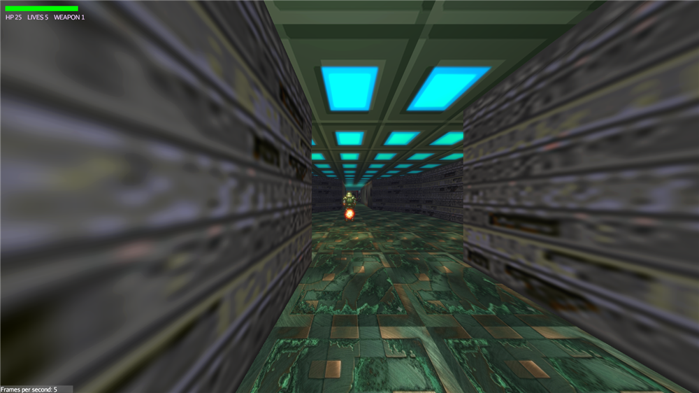

# Gloom Rebirth — vue 3D

Vue 3D temps réel (jMonkeyEngine) du portage Java de *Gloom* (Black Magic Software, Amiga, 1995).
Elle rejoue **le même jeu porté** que `../gloom-java/` : la simulation reste celle de l'assembleur
(`Objects`, `Player`, `Events`, `Map`, `host.Game`, `Sfx`/`MedPlayer` — mêmes `Mem.RAM`, mêmes
listes, même IA) ; seuls l'**affichage et l'entrée** sont remplacés. Le rasteriseur `Render` n'est
pas appelé : Rebirth lit directement l'état du monde en RAM 68k et le traduit en scène jMonkeyEngine.

> Porté par **Guillaume Monet**, avec l'assistance de Claude.



---

## 1. Séparation d'avec gloom-java

Ce projet ne contient **que le code propre à la 3D**. Le moteur fidèle n'est pas copié : ses sources
sont compilées **telles quelles** depuis le projet voisin (sourceSet Gradle), donc toute correction
de la simulation profite aux deux.

```
Gloom/
├── GloomAmiga/          ← assets + sources asm d'origine (lus à l'exécution)
├── gloom-java/          ← portage fidèle 2D : moteur partagé (java/src)
└── gloom-rebirth/       ← CE projet
    ├── hd/              ← textures HD OPTIONNELLES, par épisode (hd/map1/wall_<slot>.png, floor.png, roof.png)
    ├── hd_src/          ← textures de base extraites (`gradle dumpTextures`), entrée de l'upscale
    └── java/
        ├── build.gradle ← srcDirs = src + ../../gloom-java/java/src (sans tools/, host/Main, DisplayTest)
        ├── src/gloom/rebirth/        ← Rebirth, Options, HostGlue, DesktopGlue
        ├── src/gloom/rebirth/tools/  ← TextureDump
        ├── scripts/upscale-textures.py
        └── android/     ← APK 3D séparé (RebirthActivity, Touch3d, SetupActivity, AndroidGlue)
```

Ce qui est pris dans `gloom-java` : tout `gloom.*`, `gloom.data.*` et la pile hôte réutilisée
(`host.Audio`, `Font`, `Game`, `LevelScene`, `Splat`, `GpuCheck`…). Sur Android, on prend aussi
`gloom.android.AndroidAudio` et `AssetSetup` dans `gloom-java/java/android`.

---

## 2. Compilation & exécution

### Mise en place

Les trois dépôts doivent être **côte à côte** (le build lit `../../gloom-java/java/src`, et le jeu
lit `../GloomAmiga`) :

```bash
mkdir Gloom && cd Gloom
git clone https://github.com/earok/GloomAmiga          # assets (non redistribuables, jamais copiés ici)
git clone https://github.com/guillaumemonet/gloom-java      # moteur fidèle partagé
git clone https://github.com/guillaumemonet/gloom-rebirth   # ce dépôt
```

Les textures HD (`hd/`, `hd_src/`) ne sont **pas versionnées** : elles dérivent des textures de
Gloom, donc non redistribuables. On les régénère en local (cf. « Textures HD » ci-dessous) ; sans
elles, Rebirth utilise les textures 64×64 d'origine.

### Commandes

Depuis `java/` :

```bash
gradle run                        # vue 3D (= gradle rebirth)
gradle rebirth -Dshot             # capture d'une frame 3D → ../rebirth.png, puis quitte
gradle dumpTextures -Dmap=map1_1  # extrait les textures du niveau → ../hd_src/map1/
cd android && gradle assembleDebug   # APK « Gloom Rebirth » (applicationId gloom.rebirth)
```

JDK 21, Gradle 9.x, Windows x64 (natives LWJGL). Le répertoire d'exécution est `gloom-rebirth/` :
les assets sont lus dans `../GloomAmiga`, les textures HD dans `./hd/`. Les options sont persistées
dans `~/.gloom-java/rebirth.properties` (chemin inchangé, pour garder les réglages existants).

**Carte graphique** : au démarrage, le nom du rendu (`GL_RENDERER`) est affiché ; si c'est une puce
intégrée (`Intel HD/UHD/Iris`, `AMD Radeon(TM) Graphics`, `Microsoft Basic Render`), un
**avertissement** s'affiche en console ET à l'écran (~15 s) avec le correctif : Paramètres Windows →
Système → Affichage → Graphiques → ajouter `java.exe` et `javaw.exe` → « Hautes performances ».

**Contrôles** : `W`/`S` avancer/reculer, `A`/`D` pas de côté, `←`/`→` tourner, **souris** mouselook
(curseur verrouillé), `Ctrl` tirer, `Échap` = menu contextuel (options → menu → quitter).
Toutes les touches sont **remappables** dans le menu `OPTIONS`.

### Ce que fait le rendu 3D

| Élément | Traduction 3D |
|---|---|
| Murs (zones de la map) | quads extrudés sur `WALL_H`, groupés par texture ; **reconstruits** quand une porte/anim bouge (`wallsHash`) — les portes ont leur propre matériau `PolyOffset` (anti z-fighting) |
| Sol / plafond | vrais plans texturés (plus de perspective logicielle) |
| Monstres, items, gibs, étincelles | **billboards** face-caméra avec les sprites d'origine, sélection de frame 8 directions conservée (`drawshape_8`), matériau éclairé |
| `ob_invisible` | les 3 rendus de l'original : normal, **translucide** 50 % (`drawobjtrans` — le ghoul) et **« invisible »** qui n'assombrit que le fond sans montrer sa couleur (`drawobjinvs` — powerup) |
| Vision thermique (`ob_thermo`) | second quad au même endroit, test de profondeur **inversé** (`depthFunc Greater`) → silhouette **bleue** visible uniquement là où le sprite est occulté, l'équivalent pixel du `thermostrip` colonne par colonne |
| Gore au sol (liste `gore`) | quads horizontaux posés sur le sol (décals) |
| Sang (liste `blood`) | **un seul mesh** de quads face-caméra, colorés par sommet depuis `bl_color` |
| Balles | sprite + **point light** dynamique (couleur par type d'arme : joueur orangé, ghoul vert, phantom bleu…) |
| Ambiance | torche portée par le joueur, flash de bouche au tir, textures émissives → point lights, bloom + brouillard + ombres directionnelles |
| Dégâts / mort | voile rouge plein écran (flash décroissant) |
| Écrans d'histoire, menus, game over | le framebuffer 2D de `host.Game` uploadé en overlay plein écran (même UI que le portage 2D) |

La simulation tourne à **pas de temps fixe** (1/60 s, accumulateur borné à 6 pas) : le gameplay reste
à la vitesse fidèle quel que soit le framerate d'affichage. Seule la **vitesse du joueur** est
poussée (`PLAYER SPEED`, ×1.5 par défaut) — les monstres et les balles gardent leur vitesse d'origine.

### Textures HD (optionnel)

Rebirth cherche des PNG dans `hd/<épisode>/` (ex. `hd/map1/wall_7.png`, `floor.png`, `roof.png`) et
retombe sur les textures 64×64 d'origine si le fichier manque. Chaîne de production :

```bash
gradle dumpTextures -Dmap=map1_1                                  # → ../hd_src/map1/*.png (textures de base)
python scripts/upscale-textures.py --src ../hd_src --out ../hd    # upscale IA → ../hd/map1/*.png
```

`upscale-textures.py` parcourt `hd_src/` récursivement (l'arborescence par épisode est conservée) et
prend Real-ESRGAN ncnn s'il est sur le `PATH` (`realesrgan-ncnn-vulkan`, modèle `x4plus-anime`, le
meilleur sur du pixel-art), sinon repli Pillow/LANCZOS sans IA. Ses défauts `--src hd_src --out hd`
supposent qu'on le lance depuis la racine des assets, d'où les chemins explicites ci-dessus quand on
travaille depuis `java/`.

### Menu OPTIONS

Persisté dans `~/.gloom-java/rebirth.properties` : résolution, fenêtre/plein écran, vsync (avec
`APPLY DISPLAY` qui recrée le contexte), FOV, sensibilité souris, vitesse du joueur, **taille des
particules** (`PARTICLES`, grossit sang/étincelles/gibs — voir ci-dessous) et remappage des 7 touches.

> **Note de fidélité** — les gouttes de sang font **un pixel** dans le moteur d'origine et les
> étincelles/gibs quelques pixels : à l'échelle 3D elles disparaissent purement et simplement.
> D'où le réglage `PARTICLES` (×0.5 → ×4, défaut ×1.5) qui les grossit sans toucher aux monstres
> ni aux items.

---

## 3. Avancement

| # | Sous-système | Statut |
|---|---|---|
| R1 | Rebirth : géométrie du niveau (murs, sol/plafond, portes animées) | ✅ `gloom.rebirth.Rebirth` — `gradle rebirth` |
| R2 | Rebirth : billboards (monstres/items/gibs/étincelles) + décals de gore + sang | ✅ `gloom.rebirth.Rebirth` — `gradle rebirth -Dshot` → rebirth.png |
| R3 | Rebirth : éclairage dynamique + post-effets + mouselook + HUD | ✅ `gloom.rebirth.Rebirth` |
| R4 | Rebirth : textures HD par épisode (`hd/<épisode>/`) + extraction/upscale | ✅ `gradle dumpTextures` + `scripts/upscale-textures.py` |
| R5 | Rebirth : menu OPTIONS persisté (affichage, contrôles remappables, confort, particules) | ✅ `gloom.rebirth.Options` — `~/.gloom-java/rebirth.properties` |

---

## 4. Licence & crédits

*Gloom* est © Black Magic Software. Les sources `.s`/`.bb2` d'origine sont dans le domaine public ;
les assets ne le sont pas et ne sont jamais redistribués ici (récupérés depuis
[earok/GloomAmiga](https://github.com/earok/GloomAmiga)). Portage et vue 3D : Guillaume Monet.
